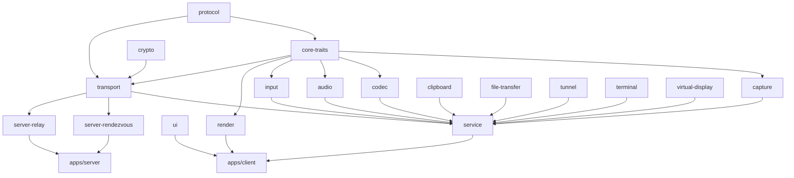
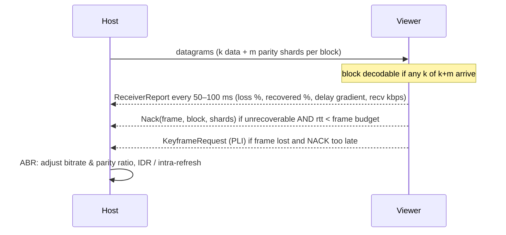

# VeloxDesk — Architecture (Contract v1, frozen at M0)

VeloxDesk is an open-source (`MIT OR Apache-2.0`), lightweight, cross-platform remote
desktop with a first-class **gaming mode** (Parsec / Sunshine+Moonlight class) and an
**office/admin mode** at feature parity with RustDesk — pure Rust, no Flutter/Electron, no vcpkg.

> This document is the contract between workers. Changes to `crates/protocol`,
> `crates/core-traits` or this file go through the coordinator only (see §10).

---

## 1. Goals and latency budget

| Stage (LAN, 1080p/1440p @120 FPS)                       | Budget  | Metric field (`StageTimings`) |
|---------------------------------------------------------|---------|-------------------------------|
| Capture + GPU color conversion (BGRA→NV12/P010/YUV444)  | ≤ 2 ms  | `capture_us`, `convert_us`    |
| HW encode (NVENC/AMF/QSV/VA-API/VT), no B-frames         | ≤ 3 ms  | `encode_us`                   |
| Packetize + FEC + network                               | ≤ 1–3 ms| `network_us`                  |
| HW decode + zero-copy import to wgpu                    | ≤ 2 ms  | `decode_us`                   |
| Present (mailbox/immediate, waitable swapchain)         | ≤ 2 ms  | `render_us`                   |
| **Glass-to-glass target**                               | **< 10–15 ms** | `total_us`             |

Every stage reports its real duration; the Performance HUD shows them (§8). No stage may
block on another thread without a bounded queue of depth ≤ 1–2 ("latest frame wins").

## 2. Workspace layout and ownership

```
Cargo.toml                 workspace root                         (coordinator)
docs/ARCHITECTURE.md       this contract                          (coordinator)
crates/protocol            wire format: media datagrams + control (coordinator)
crates/core-traits         platform-neutral traits & frame types  (coordinator)
crates/crypto              identity keys, E2EE, passwords         (net-worker)
crates/transport           QUIC, datagrams, FEC, ABR, NACK/PLI    (net-worker)
crates/server-rendezvous   ID registry, NAT hole punching         (net-worker)
crates/server-relay        zero-knowledge relay                   (net-worker)
apps/server                `veloxdesk-server` binary              (net-worker)
crates/capture             screen capture backends                (media-worker)
crates/codec               color conversion, HW/SW enc/dec        (media-worker)
crates/audio               loopback capture, Opus, playback       (media-worker)
crates/render              wgpu video surface + HUD               (render-ui-worker)
crates/ui                  egui screens/widgets                   (render-ui-worker)
apps/client                `veloxdesk` binary (client + host)     (render-ui-worker)
crates/input               input injection, gamepads              (sys-worker)
crates/clipboard           clipboard sync                         (sys-worker)
crates/file-transfer       chunked resumable transfer             (sys-worker)
crates/tunnel              TCP port forwarding over QUIC          (sys-worker)
crates/terminal            PTY / ConPTY                           (sys-worker)
crates/virtual-display     virtual monitor + privacy mode         (sys-worker)
crates/service             daemon, IPC, config, CLI, host session (sys-worker)
tests/  benches/           integration tests, pipeline benches    (qa-worker)
```

Dependency direction (no cycles, leaf crates never depend on apps):



`crates/service` contains the **host session pipeline** (capture→encode→transport, input
injection, feature dispatch). `apps/client` contains the **viewer pipeline**
(transport→decode→render, input capture) and also launches the host side in-process
(`veloxdesk --host`) so one binary serves both roles, like RustDesk.

## 3. ADRs (Architecture Decision Records)

### ADR-001 — Pure Rust workspace, minimal native deps
Platform APIs are reached via first-party bindings (`windows` crate, `ash`, `objc2`,
`pipewire`/`libspa`, `x11rb`). No vcpkg, no CMake-driven C++ builds on the default path.
Optional heavy deps (FFmpeg) are behind non-default cargo features.

### ADR-002 — UI: **egui** (+ `egui-wgpu`, `winit`) — chosen over Slint
* egui renders *inside our own wgpu render pass*: the video quad and the UI/HUD share one
  device, one queue, one swapchain and one present — zero extra compositing, zero copies.
  `egui_wgpu::CallbackTrait` lets us draw the video texture directly with our own pipeline.
* We own the event loop (`winit`), so raw input (relative mouse, scancodes) is read before
  the UI and the frame pacing (present mode, waitable swapchain) is fully under our control.
* Immediate mode means no retained-scene diffing; the HUD costs < 0.2 ms.
* Slint has a wgpu integration too, but it is less mature for "bring your own
  device/texture" and its renderer owns the frame loop. Slint stays an option for a future
  mobile/admin skin; `crates/ui` isolates widgets from `crates/render`.

### ADR-003 — Transport: QUIC (`quinn`) + RFC 9221 datagrams
* One QUIC connection per session. **Media (video/audio) = unreliable datagrams** with our
  own FEC; **control/input/files/tunnels/terminal = reliable streams** (one stream per
  logical channel → no head-of-line blocking between channels).
* Congestion control: quinn's BBR for streams; video bitrate is driven by our own
  delay-gradient ABR (§6) because datagrams must not be queued behind CC.
* TLS 1.3 from rustls with **raw public keys / self-signed certs derived from the Ed25519
  device identity**; peers verify the expected device ID ⇒ E2EE even through the relay.

### ADR-004 — Serialization
* **Control plane: Protocol Buffers via `prost` derive** (hand-written `#[derive(Message)]`
  structs in `crates/protocol/src/control.rs`, no `protoc`, no build.rs). Protobuf gives
  forward/backward compatibility (unknown fields ignored), and future Android/iOS/Web
  clients can use any protobuf runtime. Rule: **tags are never reused or renumbered**;
  removed fields become `reserved` comments.
* **Media plane: fixed 24-byte little-endian binary header** (`crates/protocol/src/media.rs`)
  — zero allocation parse, no varints on the hot path.
* Stream framing: `u32 LE length | protobuf Envelope` (max 16 MiB per message).

### ADR-005 — FEC: Reed-Solomon over GF(2^8) (`reed-solomon-simd` / `reed-solomon-erasure`)
Systematic RS, configurable parity ratio (default 10–20%, adaptive by observed loss),
max 255 shards per block; large keyframes are split into several FEC blocks.

### ADR-006 — Threading model
* Capture, convert, encode, decode, present: **dedicated OS threads** with sync traits
  (no async executor jitter on the media path), bounded `crossbeam`/`std` channels with
  "latest wins" semantics.
* Network/control: `tokio` multi-thread runtime.
* Traits in `core-traits` that are on the media path are **synchronous**; transport traits
  are `async` (`async-trait`, dyn-compatible).

### ADR-007 — Codecs and fallbacks
Priority: GPU zero-copy HW encoder → HW encoder with CPU upload → **SW fallback**
(`openh264`, pure CPU, always available, used in CI). Decoder: D3D11VA/NVDEC, VA-API,
VideoToolbox, Vulkan Video → SW (`openh264`). Low-latency settings are mandatory:
zero B-frames, no lookahead, CBR/VBV ≈ 1 frame, infinite GOP + **intra-refresh** or
on-demand IDR (triggered by PLI).

### ADR-008 — Time base
All timestamps are **microseconds on the host's monotonic clock** (`Timestamp(u64)`).
The viewer estimates the clock offset with `Ping`/`Pong` (NTP-style, min-RTT filter) and
converts host stamps to local time to compute glass-to-glass latency.

## 4. Protocol

### 4.1 Connection and streams
1. Client connects via QUIC (direct LAN/IP, hole-punched P2P, or relay). ALPN `veloxdesk/1`.
2. Client opens the **control stream** (bidi, `StreamKind::Control`) and sends `Hello`.
3. Host replies `AuthChallenge` → client `AuthResponse` (password / key) → host
   `AuthResult` (+ granted `Permissions`, possibly after the user clicks *Accept*).
4. Host sends `SessionConfig` (`DisplayList`, chosen `VideoConfig`, audio config).
5. Media flows as datagrams; additional streams are opened per feature.

Every new uni/bi stream starts with **one byte `StreamKind`**:
`1 Control, 2 Input, 3 Clipboard, 4 FileTransfer, 5 Tunnel, 6 Terminal, 7 Audio(reliable fallback), 8 Video(reliable fallback)`.

### 4.2 Media datagram header (24 bytes, little-endian)

| Off | Size | Field          | Notes |
|-----|------|----------------|-------|
| 0   | 1    | `ver_kind`     | high nibble = version (1), low nibble = `MediaKind` (1 video, 2 audio, 3 FEC-probe, 4 gamepad-state) |
| 1   | 1    | `flags`        | bit0 KEYFRAME, bit1 PARITY shard, bit2 END_OF_FRAME, bit3 HDR, bit4 RECOVERY_POINT (intra-refresh complete) |
| 2   | 1    | `stream_id`    | display index (video) / audio track |
| 3   | 1    | `block_index`  | FEC block within frame |
| 4   | 4    | `frame_id`     | u32, wraps; audio = packet seq |
| 8   | 2    | `shard_index`  | 0..data+parity |
| 10  | 1    | `data_shards`  | k (1..=255) |
| 11  | 1    | `parity_shards`| m (0..=255-k) |
| 12  | 1    | `block_count`  | total FEC blocks in frame |
| 13  | 1    | `codec`        | `VideoCodec` / `AudioCodec` id |
| 14  | 2    | `shard_len`    | payload bytes per shard in this block (all shards padded equal) |
| 16  | 4    | `block_len`    | real (unpadded) data bytes in this block |
| 20  | 4    | `capture_ts`   | low 32 bits of host capture `Timestamp` (µs) |

Payload follows the header. Max datagram payload is taken from
`quinn::Connection::max_datagram_size()` (typically ~1200 B); shard size is chosen so
`24 + shard_len ≤ max_datagram_size`.

### 4.3 Control messages (protobuf `Envelope.oneof`)
Session: `Hello, AuthChallenge, AuthResponse, AuthResult, SessionConfig, Ping, Pong, Close`.
Video/ABR: `VideoConfig, KeyframeRequest (PLI), Nack, ReceiverReport, BitrateUpdate, SwitchDisplay`.
Input: `InputEvent` (mouse abs/rel/button/wheel, key scancode, text, gamepad state, touch), `CursorShape`, `CursorPosition`, `InputFeedback` (rumble).
Features: `ClipboardData, FileRequest/FileChunk/FileAck, TunnelOpen/TunnelResult, TerminalOpen/TerminalData/TerminalResize, PrivacyMode, Permissions`.
Rendezvous (`crates/protocol::rendezvous`): `RegisterPeer, RegisterOk, PunchRequest, PunchHole, PunchAck, RelayRequest, RelayOffer, PeerLookup, PeerInfo`.

## 5. Zero-copy paths per OS

| OS | Capture | Convert | Encode | Decode | Render import |
|----|---------|---------|--------|--------|---------------|
| Windows | DXGI Desktop Duplication / WGC → `ID3D11Texture2D` | D3D11 compute/VideoProcessor BGRA→NV12/P010 on GPU | NVENC (D3D11 input) / AMF / QSV via Media Foundation (D3D11 device manager) | D3D11VA (MF) → NV12 texture | shared NT handle → `wgpu` DX12 `create_texture_from_hal` |
| Linux | PipeWire screencast (DMA-BUF) / X11 SHM fallback | Vulkan compute / VA-API VPP | VA-API (DMA-BUF import) / NVENC (CUDA) / Vulkan Video | VA-API → DMA-BUF | `wgpu` Vulkan hal + `VK_EXT_external_memory_dma_buf` |
| macOS | ScreenCaptureKit → `IOSurface` | VT pixel transfer | VideoToolbox | VideoToolbox → `CVPixelBuffer`/IOSurface | Metal `newTextureWithDescriptor:iosurface:` via wgpu hal |
| Any (fallback) | CPU frame | CPU (SIMD) | openh264 | openh264 | `queue.write_texture` |

The frame type expressing this is `core_traits::video::FrameData { Cpu(..) | Gpu(GpuFrame) }`;
`GpuHandle` enumerates `D3D11Texture`, `DmaBuf`, `IoSurface`, `VulkanImage`. Consumers check
`VideoEncoder::caps().gpu_input` / renderer caps and fall back to CPU readback **only**
when the zero-copy path is unavailable, reporting it in the HUD (`zero_copy: bool`).

## 6. Reliability: FEC, NACK, PLI, ABR



* **ABR (GCC-like):** viewer computes the one-way delay gradient per frame group
  (Kalman/trendline over arrival vs capture deltas). Overuse ⇒ multiplicative decrease
  (×0.85); normal ⇒ additive increase (+5%/s up to cap); loss > 10% ⇒ hard decrease.
* **Parity ratio:** `m = ceil(k * clamp(2 × observed_loss, 0.05, 0.5))`.
* **Recovery:** decoder never shows corrupted frames; on unrecoverable loss the viewer
  freezes the last good frame and sends PLI; host answers with IDR or intra-refresh wave.

## 7. Security model
* Device identity: **Ed25519** keypair generated on first run; **Device ID** = 9-digit
  number derived from the public key hash (human-friendly, like RustDesk) + full key
  fingerprint for verification.
* Transport: TLS 1.3 (rustls) with a self-signed certificate signed by the device key;
  custom verifier checks the peer key against the expected ID/whitelist ⇒ relay sees only
  ciphertext (zero-knowledge).
* Auth: one-time password (rotating, 6–8 chars) and/or permanent password stored as
  **Argon2id** hash; password proof = `HMAC(argon2id(password, salt), challenge)` — never
  sent in clear even inside TLS. Public-key whitelist allows passwordless trusted peers.
* Accept dialog with granular `Permissions` (view, input, clipboard, files, audio,
  tunnel, terminal, restart, privacy-mode).

## 8. Metrics / Performance HUD
`core_traits::metrics::StageTimings` travels with each frame (host stages in
`FrameTimingReport`, viewer stages measured locally). HUD line:

`Capture 0.6 | Encode 2.1 | Net 0.9 (RTT 0.4) | Decode 1.2 | Render 0.8 | Total 5.6 ms · 120 fps · NVENC H.265 HW · 38.2 Mb/s · loss 0.3% · FEC rec 100% · P2P Direct`

## 9. Milestones
* **M0** contracts + skeleton (this document), `cargo check/test --workspace` green.
* **M1** LAN MVP: real capture → encode (HW w/ SW fallback) → QUIC datagrams + RS FEC →
  decode → wgpu render + mouse/keyboard + HUD with real per-stage ms.
* **M2** self-hosted rendezvous/relay, NAT punching, E2EE, passwords/accept, LAN direct,
  automatic relay fallback.
* **M3** gaming: zero-copy GPU path, pointer lock, virtual gamepads, Opus low-latency,
  ABR verified under loss.
* **M4** RustDesk parity: clipboard, files (resume/zstd), tunnels, terminal,
  multi-monitor, service+IPC+CLI, virtual display / privacy mode.

## 10. Working rules for the swarm
1. Edit only crates you own. Need a contract change? Ask the coordinator on the board.
2. Add dependencies **in your crate's `Cargo.toml`** (explicit versions). Don't touch the
   root `Cargo.toml` except via the coordinator.
3. Build with your own target dir to avoid lock contention:
   `$env:CARGO_TARGET_DIR="target/<your-name>"` and `cargo check -p <crate>`.
   The sandbox has no network: run `cargo fetch` (or `cargo add`) once with network
   access, then build with `--offline`.
4. Other-OS backends behind `#[cfg(target_os = ...)]` with documented interfaces; the
   current OS (Windows dev box, Linux in CI) must work for real end-to-end.
5. No `todo!()`/`unimplemented!()`/fake data on the critical path of a closed milestone.
6. `cargo clippy -p <crate> --all-targets -- -D warnings` and `cargo test -p <crate>` must
   pass before you report done.
